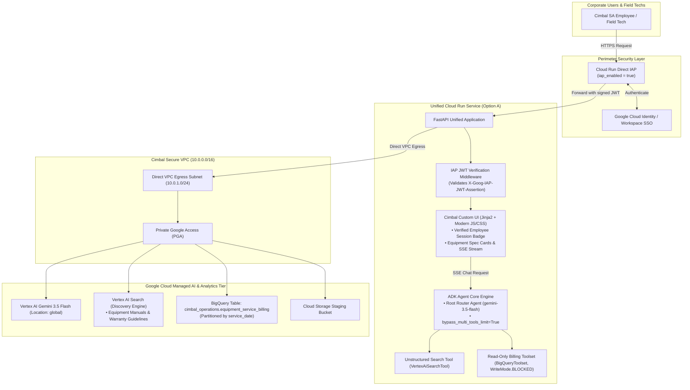

# Specification: Cimbal SA Secure Operations & Agriculture Intelligence Agent

## 1. Overview & Business Context

**Cimbal SA** is a prominent retail and field service enterprise specializing in agricultural equipment (tractors, combine harvesters, planters, sprayers, and precision agriculture systems). The organization enforces strict enterprise security and data privacy mandates.

This track implements a secure, conversational operational intelligence platform tailored for Cimbal SA's field technicians, dealership operations staff, and sales consultants. The solution adapts the multi-tool agent architecture from the previous engagement with two major architectural enhancements:

1. **VPC Network Isolation & Private Transit**: All compute workloads run inside a custom Virtual Private Cloud (VPC) leveraging **Direct VPC Egress** and **Private Google Access (PGA)** to privately communicate with Vertex AI, BigQuery, and Discovery Engine over Google's internal backbone with zero public internet transit.
2. **Direct IAP & Custom FastAPI Frontend**: Replaces the default out-of-the-box ADK Web UI with a unified, customized **FastAPI web application** secured by **Direct Identity-Aware Proxy (IAP)** on Cloud Run. Server-side middleware cryptographically validates the signed `X-Goog-IAP-JWT-Assertion` header to extract the authenticated employee identity for session tracking and role-based access control.

---

## 2. Architecture & Data Flow



---

## 3. Functional Requirements

### 3.1 Direct IAP Security & Cryptographic Middleware
- Enable Direct IAP natively on Cloud Run via `iap_enabled = true` in Terraform.
- Grant `roles/run.invoker` to the IAP Service Agent (`service-[PROJECT_NUMBER]@gcp-sa-iap.iam.gserviceaccount.com`).
- Implement `IAPAuthMiddleware` in FastAPI:
  - Intercept incoming requests.
  - In production, extract and verify `X-Goog-IAP-JWT-Assertion` (ES256 signature, issuer `https://cloud.google.com/iap`, audience `/projects/<PROJECT_NUMBER>/locations/<LOCATION>/services/<SERVICE_NAME>`, expiration).
  - In local development/testing, support configurable mock bypass when `IAP_BYPASS_DEV=TRUE`.
  - Extract user identity (`email`, `sub`) and inject into `request.state.user`.

### 3.2 Custom Frontend (Replacing ADK Web)
- Package a responsive, branded HTML/CSS/JS frontend served directly by FastAPI via Jinja2 templates and static asset routes.
- **Features**:
  - Authenticated user header badge displaying the verified employee email and role.
  - Natural-language chat interface connecting via Server-Sent Events (`/api/v1/chat/stream`).
  - Structured UI rendering for equipment models, warranty policies, and service billing tables.
  - Source citation drawers showing exact document excerpts from Discovery Engine.

### 3.3 Domain Data Model & Storage

#### Unstructured Policy Corpus (`data/equipment_docs/`)
- `equipment_warranty_guidelines.pdf`: Manufacturer warranty coverage windows, field service certification, emergency repair multipliers (1.5x during harvest season).
- `machinery_operator_manuals.pdf`: Preventive maintenance specs, hydraulic oil intervals, telematics diagnostic codes for combines and tractors.
- `regional_service_rates.pdf`: Standard labor rates, technician travel allowances across regional dealership hubs.

#### Structured BigQuery Warehouse (`cimbal_operations.equipment_service_billing`)
```sql
CREATE TABLE IF NOT EXISTS `<GCP_PROJECT_ID>.cimbal_operations.equipment_service_billing` (
  entry_id STRING NOT NULL OPTIONS(description="Unique service log ID (e.g. SRV-2001)"),
  service_date DATE NOT NULL OPTIONS(description="Date work was performed"),
  equipment_model STRING NOT NULL OPTIONS(description="Machinery model (e.g. Combine Harvester X9, Tractor 8R)"),
  customer_name STRING NOT NULL OPTIONS(description="Farm / Agribusiness client"),
  technician_name STRING NOT NULL OPTIONS(description="Certified field technician name"),
  dealership_region STRING NOT NULL OPTIONS(description="Regional dealership hub (Midwest, South, West)"),
  labor_hours FLOAT64 NOT NULL OPTIONS(description="Labor duration in hours"),
  hourly_rate_usd FLOAT64 NOT NULL OPTIONS(description="Hourly labor rate in USD"),
  parts_cost_usd FLOAT64 NOT NULL OPTIONS(description="Parts and consumables cost in USD"),
  is_warranty_claim BOOL NOT NULL OPTIONS(description="True if covered by warranty, False if customer billed"),
  task_category STRING NOT NULL OPTIONS(description="Work category (Diagnostics, Overhaul, Hydraulics, Maintenance)"),
  technician_notes STRING OPTIONS(description="Detailed service notes")
)
PARTITION BY service_date
CLUSTER BY equipment_model, technician_name, dealership_region;
```

### 3.4 Multi-Tool Routing Agent
- `RootAgent` using `gemini-3.5-flash` with `canonical_model.client_kwargs = {"location": "global"}`.
- Unstructured tool: `VertexAiSearchTool` with `bypass_multi_tools_limit=True` querying the Discovery Engine datastore.
- Structured tool: `BigQueryToolset` with `BigQueryToolConfig(write_mode=WriteMode.BLOCKED)`.
- System prompt enforcing anti-hallucination, exact citations, and dynamic SQL generation (`SUM(labor_hours * hourly_rate_usd + parts_cost_usd)`).

---

## 4. Acceptance Criteria

- [ ] Cloud Run Terraform definition specifies `iap_enabled = true` and binds Direct VPC Egress to the private subnet.
- [ ] FastAPI backend verifies `X-Goog-IAP-JWT-Assertion` cryptographically with unit test coverage.
- [ ] Custom frontend renders cleanly and streams agent responses via SSE.
- [ ] BigQuery toolset rejects all mutation attempts (`WriteMode.BLOCKED`).
- [ ] 100% of unit tests pass via `pytest tests/`.
