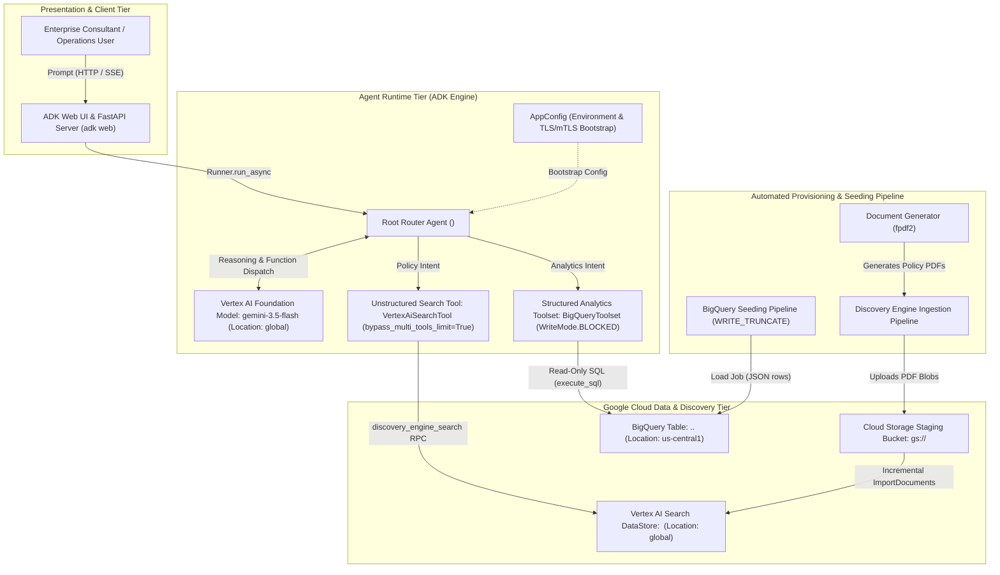
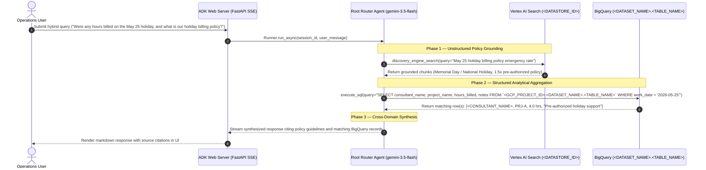

# Enterprise Operations & HR Intelligence Agent — Rebuildable Solution Specification (SSOT)

> **Asset ID**: `pso-asset-ai-ops-intelligence-agent`  
> **Source Practice**: Google Cloud Consulting (GCC) — Applied AI & Data Engineering  
> **Compliance**: Google Cloud Delta & PSO Sanitized (Zero Customer IP / PII)  
> **Target GCP Services**: Vertex AI (`gemini-3.5-flash`), Vertex AI Search (Discovery Engine), BigQuery, Cloud Storage  
> **Primary Languages & IaC**: Python 3.11+, Google Agent Development Kit (ADK), Terraform 1.6+, Docker  

---

## 1. Solution Intent & Domain Context

### 1.1 Problem Statement

Global enterprise consulting and technology delivery organizations operating across multiple international jurisdictions routinely maintain critical operational knowledge across two disconnected data silos:

1. **Unstructured Enterprise Policies & Regulatory Documents**: Country-specific policy handbooks, public holiday calendars, parental/maternity/paternity leave entitlements, paid time off (PTO) accruals, healthcare and retirement benefits documentation, and internal operational guidance.
2. **Structured Project Tracking & Financial Billing Records**: Quantitative transactional time-tracking data stored in cloud analytical warehouses (e.g., BigQuery), detailing consultant hours, billing rates, project identifiers, task categories, billable versus non-billable classification, and delivery notes.

Operations staff, people partners, engagement managers, and consultants require immediate answers to both domain-specific queries and complex hybrid cross-domain questions (for example, determining whether hours billed on a national holiday complied with corporate holiday billing policies and authorized premium rates). Manually cross-referencing document repositories with SQL database consoles is inefficient, error-prone, and presents severe data mutation risks if conversational interfaces lack strict read-only execution guardrails.

### 1.2 Target Outcomes

- **Single-Agent Multi-Tool Conversational Orchestration**: Deliver a responsive conversational web interface powered by Google Agent Development Kit (ADK) Web and Vertex AI (`gemini-3.5-flash`) capable of dynamic, single-turn routing between unstructured semantic search and structured SQL analytics without context-switching friction.
- **Strict Read-Only Analytical Data Governance**: Enforce non-bypassable, programmatic read-only restrictions (`WriteMode.BLOCKED`) at the SDK and agent prompt levels, guaranteeing conversational users cannot execute DML or DDL (`INSERT`, `UPDATE`, `DELETE`, `DROP`, `ALTER`) against financial billing records.
- **Grounded Semantic Retrieval with Source Attribution**: Integrate Vertex AI Search (Discovery Engine) over unstructured enterprise PDF corpora, returning relevance-ranked text chunks with explicit document citations and strict anti-hallucination constraints.
- **Deterministic, Idempotent Automated Provisioning**: Provide an automated, scriptable provisioning pipeline to generate standardized policy documentation, stage artifacts in Cloud Storage, initialize Discovery Engine search datastores, and seed BigQuery tables using time-relative dynamic dates and `WRITE_TRUNCATE` semantics.
- **Modular, Rebuildable Engineering Baseline**: Define an end-to-end specification satisfying the **Augment Rebuild Test**, enabling practitioners to regenerate the entire multi-tool agent platform from scratch in any Google Cloud environment.

---

## 2. Architecture & Data Flow Topology

### 2.1 Component Interaction Diagram



### 2.2 Sequence Diagram: Hybrid Cross-Domain Execution

The following sequence illustrates how the single root agent processes a hybrid prompt requiring both unstructured policy retrieval and structured SQL execution in a single conversational turn:



### 2.3 Network & Security Boundaries

- **Authentication & Identity**:
  - Application Default Credentials (ADC) via `google.auth.default()`. No static service account keys, API tokens, or hardcoded credentials permitted in code or environment files.
  - Runtime service account (`<SERVICE_ACCOUNT_EMAIL>`) enforced with the Principle of Least Privilege:
    - `roles/aiplatform.user`: Vertex AI Gemini model invocation.
    - `roles/discoveryengine.viewer`: Read-only semantic search execution against the Discovery Engine data store.
    - `roles/bigquery.jobUser`: Running BigQuery query jobs.
    - Dataset-level `roles/bigquery.dataViewer`: Read-only table queries against `<DATASET_NAME>`.
  - Provisioning pipeline (CI/CD / admin) isolated with elevated setup roles (`roles/storage.admin`, `roles/discoveryengine.admin`, `roles/bigquery.dataEditor`).
- **Database Write Protection**:
  - Double-layer defense against prompt injection and unauthorized mutation:
    1. **SDK Enforcement**: `BigQueryToolConfig(write_mode=WriteMode.BLOCKED)` rejects any non-`SELECT` statement prior to query job submission.
    2. **System Prompt Guardrail**: Explicit instructions restricting generated SQL strictly to `SELECT` statements with required column projections.
- **TLS/mTLS & Certificate Verification**:
  - Pre-flight bootstrap routine (`_ensure_ssl_cert_file`) dynamically validates root CA bundles (`certifi.where()` or `/etc/ssl/cert.pem`) to ensure uninterrupted TLS 1.3 / mTLS streams for both synchronous HTTP and asynchronous Server-Sent Events (`httpx.AsyncClient`).

---

## 3. Data Models & Schemas

### 3.1 Analytical Warehouse Schema (BigQuery DDL)

The analytical data warehouse maintains project billing and time logs within a strongly typed, partitioned table:

```sql
-- Partitioned and Clustered Analytical Table for Operations Tracking
CREATE TABLE IF NOT EXISTS `<GCP_PROJECT_ID>.<DATASET_NAME>.<TABLE_NAME>` (
  entry_id STRING NOT NULL OPTIONS(description="Unique billing log entry identifier (e.g., LOG-1001)"),
  work_date DATE NOT NULL OPTIONS(description="Date the hours were logged (YYYY-MM-DD)"),
  project_id STRING NOT NULL OPTIONS(description="Engagement / Project identifier (e.g., PRJ-A, PRJ-B)"),
  project_name STRING NOT NULL OPTIONS(description="Engagement / Project display name"),
  client_name STRING NOT NULL OPTIONS(description="Client organization name"),
  consultant_name STRING NOT NULL OPTIONS(description="Consultant full name"),
  country STRING NOT NULL OPTIONS(description="Consultant operational jurisdiction / country"),
  role STRING NOT NULL OPTIONS(description="Consultant role on the project (e.g., Cloud Architect, Lead Engineer)"),
  hours_billed FLOAT64 NOT NULL OPTIONS(description="Number of hours logged for the entry"),
  hourly_rate_usd FLOAT64 NOT NULL OPTIONS(description="Billing rate in USD per hour"),
  is_billable BOOL NOT NULL OPTIONS(description="True if client-billable, False if internal operational activity"),
  task_category STRING NOT NULL OPTIONS(description="Work category (Architecture, Development, Analytics, Discovery, Testing, Support)"),
  notes STRING OPTIONS(description="Detailed summary of work completed")
)
PARTITION BY work_date
CLUSTER BY project_id, consultant_name, country;
```

#### Data Dictionary

| Column Name | Data Type | Mode | Description |
| :--- | :--- | :--- | :--- |
| `entry_id` | `STRING` | `REQUIRED` | Unique primary identifier for the billing entry (e.g., `LOG-1001`). |
| `work_date` | `DATE` | `REQUIRED` | Date work was performed; partition key for query cost optimization. |
| `project_id` | `STRING` | `REQUIRED` | Unique project tracking code (e.g., `PRJ-A`, `PRJ-B`, `PRJ-C`). |
| `project_name` | `STRING` | `REQUIRED` | Display name of the consulting engagement. |
| `client_name` | `STRING` | `REQUIRED` | Client enterprise name. |
| `consultant_name` | `STRING` | `REQUIRED` | Full name of the delivery consultant logging time. |
| `country` | `STRING` | `REQUIRED` | Operational jurisdiction (e.g., `US`, `Argentina`). |
| `role` | `STRING` | `REQUIRED` | Consultant functional title (e.g., `Principal Architect`, `DevOps Lead`). |
| `hours_billed` | `FLOAT64` | `REQUIRED` | Quantitative duration logged (e.g., `4.0`, `8.0`). |
| `hourly_rate_usd` | `FLOAT64` | `REQUIRED` | Hourly consulting rate in USD. |
| `is_billable` | `BOOL` | `REQUIRED` | Flag distinguishing client-billable revenue hours from internal hours. |
| `task_category` | `STRING` | `REQUIRED` | Normalized work category (`Architecture`, `Development`, `Testing`, etc.). |
| `notes` | `STRING` | `NULLABLE` | Narrative description of tasks performed. |

### 3.2 Unstructured Policy Corpus & Discovery Engine Schema

- **Staging Cloud Storage Bucket**: `gs://<BUCKET_NAME>` (e.g., `gs://<GCP_PROJECT_ID>-hr-docs`).
- **Data Schema**: `content` (Unstructured PDF documents).
- **Import Configuration**: `DocumentServiceClient.import_documents` using `ReconciliationMode.INCREMENTAL`.
- **DataStore Specification**:
  - `DataStore.industry_vertical`: `IndustryVertical.GENERIC`
  - `DataStore.solution_types`: `[SolutionType.SOLUTION_TYPE_SEARCH]`
  - `DataStore.content_config`: `ContentConfig.CONTENT_REQUIRED`
- **Serving Configuration**: `servingConfigs/default_config` queried with `SearchResultMode.CHUNKS` (chunk-level grounding passages with fallback to full document metadata).
- **Policy Corpus Structure**:
  1. **Regional Holidays Policy (`regional_holidays.pdf`)**:
     - Jurisdiction A holidays (e.g., 10 paid annual public holidays).
     - Jurisdiction B holidays (e.g., 12 statutory holidays / `Feriados Nacionales`).
     - Shared calendar dates (e.g., May 25).
     - Emergency holiday billing rules: 1.5x hourly rate multiplier for pre-authorized production deployments on statutory holidays.
  2. **Jurisdiction A Benefits & Leave Policy (`benefits_jurisdiction_a.pdf`)**:
     - Parental leave: 12 weeks (60 business days) at 100% paid compensation.
     - Ramp-back program: 4 weeks at 80% schedule at full pay.
     - Paid time off (PTO): 20 to 25 business days based on tenure.
     - Healthcare coverage: Medical/Dental/Vision PPO and HDHP with HSA contribution.
     - Retirement: 401(k) retirement plan with employer matching.
  3. **Jurisdiction B Benefits & Leave Policy (`benefits_jurisdiction_b.pdf`)**:
     - Paternal & co-parent leave: 6 weeks (30 business days) at 100% paid compensation.
     - Maternity leave: 120 calendar days.
     - Gradual return program: 6 hours/day during the initial month post-leave.
     - Childcare reimbursement: Up to $250 USD/month stipend.
     - Annual leave: 15 to 25 business days (`días hábiles`).
     - Healthcare coverage: Comprehensive private medical tier (`Prepaga`).
     - Split payroll currency protection.

---

## 4. Interfaces & API Contracts

### 4.1 Web & Application Server Endpoints

The solution runtime is packaged as an ADK Web application powered by FastAPI and Uvicorn:

| Method | Route | Auth / Headers | Request Body | Response Body | Description |
| :--- | :--- | :--- | :--- | :--- | :--- |
| `GET` | `/` | None | None | HTML / JS / CSS | Serves the conversational agent web interface. |
| `POST` | `/run_async` | Session Cookie / Token | `{"session_id": "...", "message": "..."}` | SSE Stream (`text/event-stream`) | Dispatches prompt to `Runner.run_async`, streaming tool calls and final text. |
| `GET` | `/healthz` | None (Internal) | None | `{"status": "SERVING"}` | Liveness and readiness probe for container orchestrators (Cloud Run / GKE). |

### 4.2 Tool Execution Contracts

#### 4.2.1 `discovery_engine_search` (Unstructured Policy Tool)

- **Declaration**: Automatically converted from `VertexAiSearchTool` via ADK's `bypass_multi_tools_limit=True` flag into a function declaration.
- **Input Parameters**:
  ```json
  {
    "type": "object",
    "required": ["query"],
    "properties": {
      "query": {
        "type": "string",
        "description": "Natural language search query regarding HR policies, holidays, leave, or benefits."
      }
    }
  }
  ```
- **Output Contract**:
  ```json
  {
    "type": "object",
    "properties": {
      "results": {
        "type": "array",
        "items": {
          "type": "object",
          "properties": {
            "title": { "type": "string" },
            "uri": { "type": "string" },
            "content": { "type": "string" },
            "relevance_score": { "type": "number" }
          }
        }
      }
    }
  }
  ```

#### 4.2.2 `execute_sql` (Structured Analytical Tool)

- **Declaration**: Provided by `BigQueryToolset` with `BigQueryToolConfig(write_mode=WriteMode.BLOCKED)`.
- **Input Parameters**:
  ```json
  {
    "type": "object",
    "required": ["query"],
    "properties": {
      "query": {
        "type": "string",
        "description": "Read-only SQL SELECT query targeting the analytical billing table."
      }
    }
  }
  ```
- **Output Contract**:
  ```json
  {
    "type": "object",
    "properties": {
      "rows": {
        "type": "array",
        "items": { "type": "object" },
        "description": "Array of result row objects keyed by projected column names."
      },
      "total_rows": { "type": "integer" }
    }
  }
  ```

---

## 5. Core Processing & Functional Workflows

### 5.1 Single-Agent Multi-Tool Routing Workflow

1. **Intent Analysis & Tool Selection**:
   - The user prompt is ingested by `RootAgent` powered by `gemini-3.5-flash`.
   - The agent system prompt defines the table schema, column semantics, and unstructured policy scope.
   - **Policy Intent**: Prompts referencing holiday dates, parental leave durations, vacation accrual rules, or benefit tiers route to `discovery_engine_search`.
   - **Quantitative Intent**: Prompts requesting hour aggregates, consultant rates, revenue calculations (`hours_billed * hourly_rate_usd`), or task breakdowns route to `execute_sql`.
   - **Hybrid Intent**: Prompts correlating dates or policies with logged activities trigger both tools sequentially or concurrently within the same conversational turn.
2. **Coexistence Contract**:
   - Setting `bypass_multi_tools_limit=True` on `VertexAiSearchTool` ensures ADK exposes Discovery Engine as a callable function declaration, avoiding Vertex AI Gemini's `400 INVALID_ARGUMENT` restriction on mixing native retrieval grounding with custom functions.

### 5.2 Structured SQL Execution & Guardrails

1. **Query Construction**:
   - The agent constructs standard SQL targeting the fully qualified table name `<GCP_PROJECT_ID>.<DATASET_NAME>.<TABLE_NAME>`.
   - All revenue metrics MUST be computed using `SUM(hours_billed * hourly_rate_usd)`.
   - When filtering for billable hours, the query explicitly applies `WHERE is_billable = TRUE`.
2. **Mutation Guardrail Enforcement**:
   - If the generated query contains `INSERT`, `UPDATE`, `DELETE`, `DROP`, `ALTER`, or `CREATE`, `BigQueryToolset` raises an immediate `WriteMode.BLOCKED` validation error, preventing execution and protecting database integrity.

### 5.3 Grounded Unstructured Policy Retrieval

1. **Query Formulation & Execution**:
   - Natural language queries are passed to `discovery_engine_search`.
   - Discovery Engine queries `default_collection/dataStores/<DATASTORE_ID>` in `CHUNKS` mode.
2. **Anti-Hallucination & Citation Rules**:
   - The agent must ground every policy statement in returned search chunks, citing the specific PDF document and jurisdiction.
   - If the requested policy is not present in the indexed corpus, the agent must explicitly state that the policy is not documented, rather than extrapolating or guessing.

### 5.4 Automated Provisioning & Seeding Workflow

1. **Document Synthesis**:
   - CLI script (`generate_documents.py`) builds standardized PDF files (`regional_holidays.pdf`, `benefits_jurisdiction_a.pdf`, `benefits_jurisdiction_b.pdf`) with structured headings, tables, and policy clauses.
2. **Storage Staging & Indexing**:
   - `setup_discovery_engine.py` idempotently creates `gs://<BUCKET_NAME>`, uploads generated PDFs, provisions the Discovery Engine DataStore `<DATASTORE_ID>`, and initiates document ingestion via `import_documents`.
3. **Dynamic Warehouse Seeding**:
   - `seed_warehouse.py` generates synthetic billing records dynamically calculated relative to `datetime.date.today()` (rolling 21 business days plus designated statutory holiday entries), preventing data obsolescence for rolling date queries ("hours logged last week").
   - Executes a BigQuery load job using `WriteDisposition.WRITE_TRUNCATE` to ensure idempotency.

---

## 6. Project Structure & Dependency Graph

### 6.1 Recommended Directory Tree

```text
solution-root/
├── .env.example                            # Template for environment configuration
├── pyproject.toml                          # Build system, package metadata, and pytest config
├── requirements.txt                        # Pinned dependencies
├── README.md                               # Operator quickstart and architecture overview
├── terraform/                              # Infrastructure as Code (GCP resources)
│   ├── main.tf                             # Root Terraform configuration
│   ├── variables.tf                        # Parameterized variables
│   ├── outputs.tf                          # Output endpoints and resource IDs
│   └── modules/
│       ├── bigquery/                       # BigQuery dataset & table module
│       ├── discovery_engine/               # Vertex AI Search DataStore module
│       ├── storage/                        # GCS staging bucket module
│       └── iam/                            # Least-privilege IAM service account module
├── src/
│   ├── agent/                              # ADK conversational agent package
│   │   ├── __init__.py                     # Package entrypoint exporting root_agent
│   │   ├── agent.py                        # build_root_agent() and LlmAgent assembly
│   │   ├── config.py                       # AppConfig dataclass, .env loader, TLS bootstrap
│   │   ├── prompts.py                      # Router system prompt and routing rules
│   │   └── tools/
│   │       ├── __init__.py
│   │       ├── search_tool.py              # VertexAiSearchTool builder
│   │       └── billing_tool.py             # Read-only BigQueryToolset builder
│   └── provisioning/                       # Automated provisioning & seeding CLI
│       ├── __init__.py
│       ├── generate_documents.py           # Programmatic PDF generation (fpdf2)
│       ├── setup_discovery_engine.py       # GCS staging & Discovery Engine import
│       ├── seed_warehouse.py               # BigQuery schema & dynamic data seeding
│       ├── setup_all.py                    # Unified master provisioning orchestrator
│       └── verify_e2e.py                   # Live smoke verification CLI
└── tests/                                  # Automated test suite (100% mocked GCP dependencies)
    ├── conftest.py                         # Shared test fixtures & environment mocks
    ├── test_agent_router.py                # Router prompt & tool registration tests
    ├── test_agent_tools.py                 # Tool builders & WriteMode.BLOCKED tests
    ├── test_config.py                      # AppConfig validation & TLS cert tests
    ├── test_document_generator.py          # PDF generation tests
    ├── test_seed_warehouse.py              # Dynamic BigQuery row generator tests
    └── test_setup_discovery_engine.py      # GCS & Discovery Engine mock tests
```

### 6.2 Key Dependencies & Versions

- **Python Runtime**: Python `>=3.11, <3.14`
- **Agent Framework**: `google-adk>=0.1.0`
- **Generative AI SDK**: `google-genai>=0.1.0`
- **Google Cloud Data & Search SDKs**:
  - `google-cloud-bigquery>=3.20.0`
  - `google-cloud-discoveryengine>=0.11.0`
  - `google-cloud-storage>=2.14.0`
- **Web & Serving Runtime**:
  - `fastapi>=0.110.0`
  - `uvicorn>=0.29.0`
  - `httpx>=0.27.0`
- **Document Generation & TLS Utilities**:
  - `fpdf2>=2.7.8`
  - `certifi>=2024.2.2`
  - `python-dotenv>=1.0.1`
- **Testing & Quality Assurance**:
  - `pytest>=8.0.0`
  - `pytest-asyncio>=0.23.5`
  - `pytest-mock>=3.12.0`

---

## 7. Infrastructure & Environment Blueprint

### 7.1 Sanitized Environment Variable Dictionary

| Variable Name | Description | Example Sanitized Value |
| :--- | :--- | :--- |
| `GOOGLE_CLOUD_PROJECT` | Target Google Cloud Project ID | `<GCP_PROJECT_ID>` |
| `GOOGLE_CLOUD_LOCATION` | Regional location for BigQuery and GCS storage | `us-central1` |
| `GOOGLE_GENAI_USE_VERTEXAI` | Directs `google-genai` to use Vertex AI | `TRUE` |
| `GEMINI_MODEL` | Foundation model identifier | `gemini-3.5-flash` |
| `BQ_DATASET_ID` | BigQuery analytical dataset ID | `<DATASET_NAME>` |
| `BQ_TABLE_ID` | BigQuery billing table ID | `<TABLE_NAME>` |
| `GCS_HR_BUCKET` | Cloud Storage bucket for document staging | `<BUCKET_NAME>` |
| `VERTEX_SEARCH_LOCATION` | Discovery Engine multi-region location | `global` |
| `VERTEX_SEARCH_DATASTORE_ID` | Vertex AI Search data store identifier | `<DATASTORE_ID>` |
| `SSL_CERT_FILE` | Path to valid CA root certificate bundle | `/etc/ssl/cert.pem` |

### 7.2 Core IaC Resource Definitions (Terraform)

```hcl
# BigQuery Dataset
resource "google_bigquery_dataset" "billing_dataset" {
  dataset_id                  = var.bq_dataset_id
  location                    = var.location
  description                 = "Analytical warehouse dataset for operations tracking"
  default_table_expiration_ms = null
}

# BigQuery Table
resource "google_bigquery_table" "billing_table" {
  dataset_id = google_bigquery_dataset.billing_dataset.dataset_id
  table_id   = var.bq_table_id

  time_partitioning {
    type  = "DAY"
    field = "work_date"
  }

  clustering = ["project_id", "consultant_name", "country"]

  schema = jsonencode([
    { name = "entry_id", type = "STRING", mode = "REQUIRED", description = "Unique entry identifier" },
    { name = "work_date", type = "DATE", mode = "REQUIRED", description = "Date work performed" },
    { name = "project_id", type = "STRING", mode = "REQUIRED", description = "Project code" },
    { name = "project_name", type = "STRING", mode = "REQUIRED", description = "Project display name" },
    { name = "client_name", type = "STRING", mode = "REQUIRED", description = "Client organization" },
    { name = "consultant_name", type = "STRING", mode = "REQUIRED", description = "Consultant name" },
    { name = "country", type = "STRING", mode = "REQUIRED", description = "Consultant country" },
    { name = "role", type = "STRING", mode = "REQUIRED", description = "Project role" },
    { name = "hours_billed", type = "FLOAT64", mode = "REQUIRED", description = "Hours logged" },
    { name = "hourly_rate_usd", type = "FLOAT64", mode = "REQUIRED", description = "Hourly rate in USD" },
    { name = "is_billable", type = "BOOL", mode = "REQUIRED", description = "Client-billable flag" },
    { name = "task_category", type = "STRING", mode = "REQUIRED", description = "Work category" },
    { name = "notes", type = "STRING", mode = "NULLABLE", description = "Detailed work summary" }
  ])
}

# Cloud Storage Bucket for Document Staging
resource "google_storage_bucket" "doc_bucket" {
  name                        = var.gcs_hr_bucket
  location                    = var.location
  uniform_bucket_level_access = true
  versioning {
    enabled = true
  }
}

# Vertex AI Search DataStore
resource "google_discovery_engine_data_store" "hr_datastore" {
  location                     = var.vertex_search_location
  data_store_id                = var.vertex_search_datastore_id
  display_name                 = "Enterprise Policy DataStore"
  industry_vertical            = "GENERIC"
  content_config               = "CONTENT_REQUIRED"
  solution_types               = ["SOLUTION_TYPE_SEARCH"]
  create_advanced_site_search  = false
}

# Runtime Service Account
resource "google_service_account" "agent_sa" {
  account_id   = "sa-agent-runtime"
  display_name = "Operations Agent Runtime Service Account"
}

# IAM Role Bindings for Runtime Service Account
resource "google_project_iam_member" "aiplatform_user" {
  project = var.project_id
  role    = "roles/aiplatform.user"
  member  = "serviceAccount:${google_service_account.agent_sa.email}"
}

resource "google_project_iam_member" "discoveryengine_viewer" {
  project = var.project_id
  role    = "roles/discoveryengine.viewer"
  member  = "serviceAccount:${google_service_account.agent_sa.email}"
}

resource "google_project_iam_member" "bigquery_job_user" {
  project = var.project_id
  role    = "roles/bigquery.jobUser"
  member  = "serviceAccount:${google_service_account.agent_sa.email}"
}

resource "google_bigquery_dataset_iam_member" "dataset_viewer" {
  dataset_id = google_bigquery_dataset.billing_dataset.dataset_id
  role       = "roles/bigquery.dataViewer"
  member     = "serviceAccount:${google_service_account.agent_sa.email}"
}
```

---

## 8. Rebuild Recipe & Acceptance Criteria

### 8.1 The Rebuild Test Benchmark

This specification satisfies the **Augment Rebuild Test**: in an empty repository with zero initial source code, an AI agent or engineer can execute the phased reconstruction prompts below sequentially to rebuild, test, and run the complete multi-tool operations platform.

### 8.2 Phased Reconstruction Prompts

#### Phase A: Infrastructure & Data Provisioning Pipeline

```text
Task: Scaffold the project configuration, Terraform definitions, and automated provisioning scripts based on SPEC.md.

Requirements:
1. Create pyproject.toml, requirements.txt, and .env.example matching Section 6 and Section 7.
2. Implement terraform/ modules for BigQuery (partitioned table), Cloud Storage, Discovery Engine DataStore, and least-privilege IAM bindings matching Section 7.2.
3. In src/provisioning/:
   - generate_documents.py: Programmatically generate 3 standardized policy PDFs (regional_holidays.pdf, benefits_jurisdiction_a.pdf, benefits_jurisdiction_b.pdf) using fpdf2 matching Section 3.2.
   - setup_discovery_engine.py: Idempotently create the GCS staging bucket, upload the PDFs, ensure the Discovery Engine DataStore exists, and import documents using ReconciliationMode.INCREMENTAL.
   - seed_warehouse.py: Idempotently create the BigQuery dataset and partitioned table, generating rolling dynamic dates relative to datetime.date.today() across multiple consultants and engagements using WriteDisposition.WRITE_TRUNCATE.
   - setup_all.py: Master CLI orchestrating document generation, search indexing, and warehouse seeding with --wait and selective skip flags.
4. Acceptance:
   - python -m py_compile across all provisioning scripts succeeds.
   - terraform -chdir=terraform init and terraform -chdir=terraform validate pass with 0 errors.
```

#### Phase B: Agent Runtime, Config, & Tool Builders

```text
Task: Implement the core ADK conversational agent, tool builders, and configuration engine in src/agent/ based on Section 2, Section 4, and Section 5 of SPEC.md.

Requirements:
1. In src/agent/config.py:
   - Implement AppConfig dataclass reading environment variables with validation.
   - Implement _ensure_ssl_cert_file bootstrap setting SSL_CERT_FILE and REQUESTS_CA_BUNDLE to certifi.where() or /etc/ssl/cert.pem.
2. In src/agent/tools/search_tool.py:
   - Implement build_search_tool() instantiating VertexAiSearchTool with bypass_multi_tools_limit=True.
3. In src/agent/tools/billing_tool.py:
   - Implement build_billing_tool() instantiating BigQueryToolset with BigQueryToolConfig(write_mode=WriteMode.BLOCKED) and Application Default Credentials.
4. In src/agent/prompts.py:
   - Implement build_system_prompt() defining routing rules, fully qualified table schema, column descriptions, revenue calculation formula, and strict anti-hallucination/citation guidelines.
5. In src/agent/agent.py:
   - Implement build_root_agent() configuring LlmAgent with name, gemini-3.5-flash model, canonical_model client_kwargs location="global", tools, and instructions.
   - Export root_agent at module level.
6. Acceptance:
   - Agent package passes static imports and adheres to google-adk discovery conventions.
```

#### Phase C: Verification Suite & Automated Tests

```text
Task: Implement an automated unit test suite with 100% mocked GCP dependencies and an end-to-end verification CLI based on Section 8 of SPEC.md.

Requirements:
1. In tests/:
   - test_config.py: Test configuration loading, validation errors on missing variables, and SSL cert resolution.
   - test_agent_tools.py: Test that VertexAiSearchTool sets bypass_multi_tools_limit=True and BigQueryToolset enforces WriteMode.BLOCKED.
   - test_agent_router.py: Test root_agent instantiation, tool binding, system prompt generation, and model location binding.
   - test_document_generator.py: Test PDF synthesis and page/content structure.
   - test_seed_warehouse.py: Test rolling date row generation and schema column alignments.
   - test_setup_discovery_engine.py: Test mocked GCS bucket upload and Discovery Engine import calls.
2. In src/provisioning/verify_e2e.py:
   - Implement live verification CLI executing smoke queries against BigQuery, Discovery Engine search, and ADK agent invocation.
3. Acceptance:
   - pytest runs with 100% pass rate.
   - Coverage across src/agent/ exceeds 90%.
```

### 8.3 Verifiable Acceptance Criteria

- [ ] **Infrastructure Validation**: `terraform -chdir=terraform validate` executes with exit code `0`.
- [ ] **Data Model Compliance**: Analytical table DDL includes all 13 required columns with matching types, partition by `work_date`, and clustering by `project_id, consultant_name, country`.
- [ ] **Tool Security Guardrail**: `BigQueryToolset` configured with `WriteMode.BLOCKED`; unit tests verify mutation attempts raise validation errors.
- [ ] **Search Tool Coexistence**: `VertexAiSearchTool` initialized with `bypass_multi_tools_limit=True` to enable simultaneous function calling.
- [ ] **Test Suite Coverage**: `pytest -v tests/` executes with `100%` pass rate without requiring active cloud credentials.
- [ ] **Zero Customer IP/PII**: Clean compliance scan confirming zero unmasked customer project IDs, proprietary client names, or personal identities.
