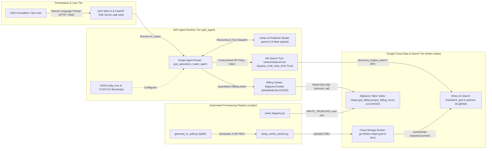
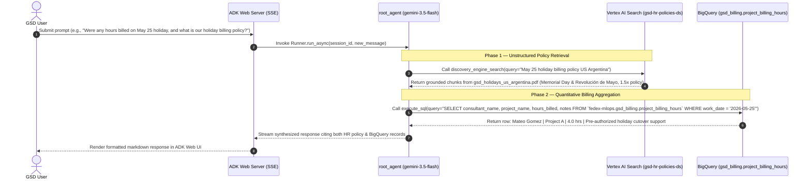
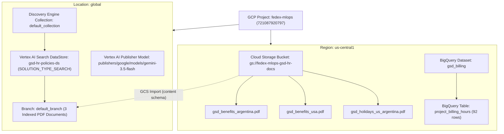
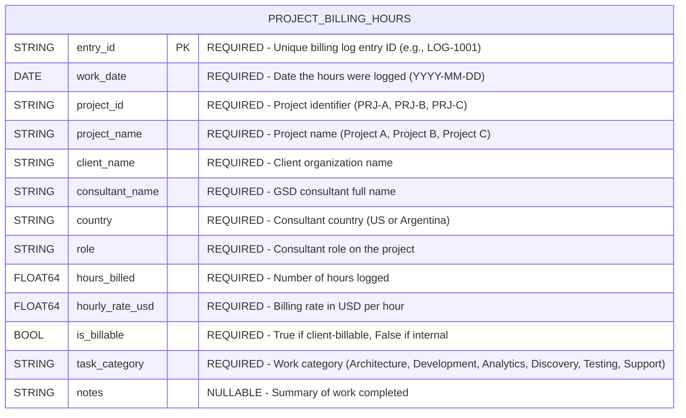
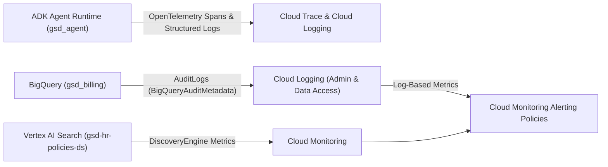
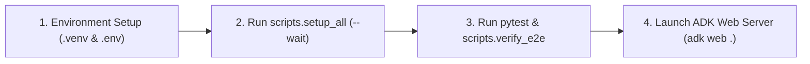

# Technical Design Document (TDD): GSD Operations & HR Intelligence Agent (`gsd-adk-app`)

> [!IMPORTANT]
> **Google Cloud Consulting (GCC) — Architecture & Engineering Deliverable**  
> This Technical Design Document defines the end-to-end architecture, data pipelines, security controls, and operational model for the **GSD (Global Software Delivery)** single-agent, multi-tool conversational platform built on the **Google Agent Development Kit (ADK)**, **Vertex AI (`gemini-3.5-flash`)**, **Vertex AI Search (Discovery Engine)**, and **BigQuery**.

---

## 1. Document Control & Metadata

### 1.1 Document Identification

| Attribute | Value |
| :--- | :--- |
| **Document Title** | Technical Design Document — GSD Operations & HR Intelligence Agent (`gsd-adk-app`) |
| **Engagement / Practice** | Google Cloud Consulting (GCC) — Applied AI & Data Engineering |
| **Client Organization** | Global Software Delivery (GSD) Consulting (United States & Argentina) |
| **Target GCP Project** | `fedex-mlops` (Project Number: `721087920797`) |
| **Author** | Principal Cloud Architect, Google Cloud Consulting (GCC) |
| **Date** | October 16, 2026 |
| **Version** | `1.0.0` (Baseline Release — Archived Spec [`2026-10-16-gsd-adk-app`](file:///Users/joaquinmen/Desktop/sdd-demo/openspec/changes/archive/2026-10-16-gsd-adk-app)) |
| **Document Status** | Approved / Implemented |

### 1.2 Version History

| Version | Date | Author | Summary of Changes |
| :--- | :--- | :--- | :--- |
| `0.1.0` | 2026-10-16 | GCC Principal Cloud Architect | Initial specification and architectural proposal ([proposal.md](file:///Users/joaquinmen/Desktop/sdd-demo/openspec/changes/archive/2026-10-16-gsd-adk-app/proposal.md), [design.md](file:///Users/joaquinmen/Desktop/sdd-demo/openspec/changes/archive/2026-10-16-gsd-adk-app/design.md)). |
| `1.0.0` | 2026-10-16 | GCC Principal Cloud Architect | Full implementation, live GCP provisioning in `fedex-mlops`, mTLS/SSL hardening, and end-to-end verification ([tasks.md](file:///Users/joaquinmen/Desktop/sdd-demo/openspec/changes/archive/2026-10-16-gsd-adk-app/tasks.md)). |

### 1.3 Reviewer Sign-Off Matrix

| Role | Stakeholder / Team | Responsibility | Sign-Off Status | Date |
| :--- | :--- | :--- | :--- | :--- |
| **Enterprise Cloud Architect** | GCC Architecture Review Board | Validates Vertex AI, ADK, Discovery Engine, and BigQuery integration patterns | Approved | 2026-10-16 |
| **Data & Analytics Lead** | GSD Operations & Finance Engineering | Approves `gsd_billing.project_billing_hours` schema and read-only SQL guardrails | Approved | 2026-10-16 |
| **People Operations Lead** | GSD HR (US & Argentina) | Approves US & Argentina holiday calendars, parental leave, and benefits corpus | Approved | 2026-10-16 |
| **Cloud Security & IAM Lead** | GSD Information Security | Approves ADC identity model, `WriteMode.BLOCKED` enforcement, and TLS/mTLS controls | Approved | 2026-10-16 |

---

## 2. Introduction & Executive Summary

### 2.1 Business Problem
**Global Software Delivery (GSD)** is a cross-border technology consulting firm operating delivery centers across the **United States** and **Argentina**. Consultants, Engagement Directors, and People Operations staff routinely require answers that span two disconnected enterprise data silos:

1. **Unstructured Human Resources & Policy Documentation**: Country-specific PDF handbooks covering US and Argentina public holidays (`Feriados Nacionales`), paternal and maternal leave entitlements, business-day vacation (`días hábiles`) vs. PTO accrual, health insurance (`Prepaga` vs. PPO/HDHP), home-office stipends, and internal training videos.
2. **Structured Project Tracking & Billing Data**: Quantitative time-tracking records stored in BigQuery tracking consultant billable and non-billable hours, hourly rates (`USD`), task categories, and delivery notes across client engagements (`Project A`, `Project B`, `Project C`).

Previously, answering operational questions—or hybrid cross-domain inquiries such as verifying whether hours logged on a bi-national holiday complied with GSD's holiday billing policy—required context-switching between document repositories and SQL consoles.

### 2.2 Solution Overview
The `gsd-adk-app` solution delivers a unified, conversational web application built on the **Google Agent Development Kit (ADK) Web** framework (`google-adk`). A single root router agent ([`root_agent`](file:///Users/joaquinmen/Desktop/sdd-demo/gsd_agent/agent.py#L38)) powered by **Vertex AI Gemini 3.5 Flash (`gemini-3.5-flash`)** dynamically routes natural-language prompts across two specialized backend integrations:

- **Vertex AI Search Tool (`VertexAiSearchTool`)**: Grounded retrieval over GSD's unstructured HR PDF corpus indexed in a Discovery Engine data store (`gsd-hr-policies-ds`).
- **BigQuery Toolset (`BigQueryToolset`)**: Read-only analytical SQL generation and execution (`WriteMode.BLOCKED`) against `fedex-mlops.gsd_billing.project_billing_hours`.

### 2.3 High-Level Architectural Goals
- **Unified Single-Agent Routing with Multi-Agent Extensibility**: Avoid conversational context handoff friction by orchestrating both tools from a single `LlmAgent` (`bypass_multi_tools_limit=True`), while isolating tool builders in modular packages ready for promotion to sub-agents (`sub_agents`) as domain complexity grows.
- **Strict Read-Only Data Governance**: Enforce programmatic write blocking (`WriteMode.BLOCKED`) alongside system-prompt constraints so conversational users can never execute DML/DDL (`INSERT`, `UPDATE`, `DELETE`, `DROP`) against financial billing tables.
- **Deterministic, Idempotent Provisioning**: Automate synthetic PDF generation, Cloud Storage ingestion, Discovery Engine datastore creation, and BigQuery table seeding via an idempotent CLI pipeline ([scripts/setup_all.py](file:///Users/joaquinmen/Desktop/sdd-demo/scripts/setup_all.py)).
- **Environment-Driven Portability**: Externalize all GCP project, region, model, bucket, datastore, and dataset identifiers into a validated configuration contract ([.env](file:///Users/joaquinmen/Desktop/sdd-demo/.env) and [gsd_agent/config.py](file:///Users/joaquinmen/Desktop/sdd-demo/gsd_agent/config.py)).

---

## 3. System & Enterprise Architecture

### 3.1 High-Level Architecture Blueprint



### 3.2 Request Routing & Execution Sequence

The sequence below illustrates how `root_agent` handles single-domain and hybrid cross-domain prompts within a single conversational turn:



### 3.3 Key Architectural Decisions & Trade-Offs

| Decision ID | Architectural Decision | Chosen Approach | Alternatives Considered & Rationale for Rejection |
| :--- | :--- | :--- | :--- |
| **ADR-01** | Coexistence of Grounding Retrieval and Function Calling | Instantiate [`VertexAiSearchTool`](file:///Users/joaquinmen/Desktop/sdd-demo/gsd_agent/tools/hr_search.py#L15-L18) with `bypass_multi_tools_limit=True` alongside [`BigQueryToolset`](file:///Users/joaquinmen/Desktop/sdd-demo/gsd_agent/tools/billing_bq.py#L28) on a single `LlmAgent`. ADK transparently converts the grounding tool into a `DiscoveryEngineSearchTool` (`discovery_engine_search`) function declaration. | **1. Raw `VertexAiSearchTool` (`bypass_multi_tools_limit=False`)**: Rejected because Vertex AI Gemini rejects requests mixing native retrieval grounding with custom function declarations (`400 INVALID_ARGUMENT`).<br>**2. Multi-agent `transfer_to_agent`**: Rejected for v1 because full agent transfer relinquishes turn control, complicating hybrid single-turn synthesis. |
| **ADR-02** | Vertex AI Gemini 3.5 Flash Endpoint Routing | Configure `GEMINI_MODEL=gemini-3.5-flash` and bind `agent.canonical_model.client_kwargs = {"location": "global"}` in [`build_root_agent`](file:///Users/joaquinmen/Desktop/sdd-demo/gsd_agent/agent.py#L35-L36) while keeping `GOOGLE_CLOUD_LOCATION=us-central1` for regional storage and compute. | **Single location variable for both LLM and BigQuery**: Rejected because `gemini-3.5-flash` is served via the Vertex AI `global` publisher endpoint, whereas BigQuery datasets and GCS buckets reside in `us-central1`. |
| **ADR-03** | Read-Only Analytical SQL Execution | Use [`BigQueryToolset`](file:///Users/joaquinmen/Desktop/sdd-demo/gsd_agent/tools/billing_bq.py#L19-L29) with `BigQueryToolConfig(write_mode=WriteMode.BLOCKED)` and inject explicit table schema metadata into [`build_router_instruction`](file:///Users/joaquinmen/Desktop/sdd-demo/gsd_agent/prompts.py#L8-L62). | **Fixed Python query functions**: Rejected because ad-hoc operational questions require flexible `GROUP BY`, date-window filtering, and multi-column aggregations (`SUM(hours_billed)`, `SUM(hours_billed * hourly_rate_usd)`). |
| **ADR-04** | Time-Relative Synthetic Billing Data Seeding | Generate 21 days of rolling weekday billing logs relative to `datetime.date.today()` plus explicit 2026 holiday records using `WriteDisposition.WRITE_TRUNCATE` in [`seed_bigquery_billing_table`](file:///Users/joaquinmen/Desktop/sdd-demo/scripts/seed_bigquery.py#L172-L210). | **Static CSV fixture dates**: Rejected because natural-language queries such as *"total hours billed over the last week"* would return zero rows once static dates age past 7 days. |

---

## 4. Detailed Technical Design

### 4.1 Infrastructure & Cloud Resource Hierarchy

All cloud resources are provisioned within the Google Cloud project `fedex-mlops` (`721087920797`) with strict separation between regional storage/analytics (`us-central1`) and global AI/Discovery services (`global`):



| Resource Type | Resource Identifier / URI | Location | Configuration Details |
| :--- | :--- | :--- | :--- |
| **Vertex AI Foundation Model** | `projects/fedex-mlops/locations/global/publishers/google/models/gemini-3.5-flash` | `global` | Invoked via `google-genai` Vertex AI backend (`GOOGLE_GENAI_USE_VERTEXAI=TRUE`). |
| **Cloud Storage Bucket** | `gs://fedex-mlops-gsd-hr-docs` | `us-central1` | Stores generated HR policy PDFs (`application/pdf`). |
| **Vertex AI Search DataStore** | `projects/fedex-mlops/locations/global/collections/default_collection/dataStores/gsd-hr-policies-ds` | `global` | `IndustryVertical.GENERIC`, `SolutionType.SOLUTION_TYPE_SEARCH`, `ContentConfig.CONTENT_REQUIRED`. |
| **BigQuery Dataset** | `fedex-mlops.gsd_billing` | `us-central1` | Regional analytical dataset for GSD project tracking and time logs. |
| **BigQuery Table** | `fedex-mlops.gsd_billing.project_billing_hours` | `us-central1` | Strongly typed 13-column billing log table seeded via `WRITE_TRUNCATE`. |

### 4.2 Codebase & Module Structure

The repository follows a modular layout separating runtime agent definitions (`gsd_agent/`), idempotent infrastructure/data provisioning scripts (`scripts/`), formal OpenSpec specifications (`openspec/`), and automated test suites (`tests/`):

```text
sdd-demo/
|-- .env                                    # Runtime & provisioning environment variables
|-- .env.example                            # Version-controlled environment template
|-- pyproject.toml                          # Package metadata, dependencies, and pytest config
|-- requirements.txt                        # Pinned runtime & test dependencies
|-- README.md                               # Operator quickstart and sample prompts
|-- docs/
|   +-- TDD_GSD_ADK_APP.md                  # Formal GCC Technical Design Document
|-- gsd_agent/                              # ADK Web discoverable agent package
|   |-- __init__.py                         # Exports root_agent for ADK Web discovery
|   |-- agent.py                            # Defines build_root_agent() and root_agent
|   |-- config.py                           # GSDConfig dataclass, .env loader, TLS/mTLS bootstrap
|   |-- prompts.py                          # System prompt and routing guardrails
|   +-- tools/
|       |-- __init__.py
|       |-- hr_search.py                    # VertexAiSearchTool builder
|       +-- billing_bq.py                   # Read-only BigQueryToolset builder
|-- scripts/                                # Automated provisioning & verification CLI scripts
|   |-- generate_hr_pdfs.py                 # Generates 3 mock GSD HR PDFs via fpdf2
|   |-- setup_vertex_search.py              # Provisions GCS bucket, DataStore, and imports PDFs
|   |-- seed_bigquery.py                    # Creates & seeds gsd_billing.project_billing_hours
|   |-- setup_all.py                        # Unified orchestrator for all provisioning stages
|   +-- verify_e2e.py                       # Live end-to-end BigQuery, Discovery Engine & ADK check
|-- openspec/                               # Spec-Driven Development (SDD) artifacts
|   |-- specs/                              # Canonical capability specifications
|   |   |-- adk-web-router-agent/spec.md
|   |   |-- hr-policy-search/spec.md
|   |   +-- project-billing-analytics/spec.md
|   +-- changes/archive/2026-10-16-gsd-adk-app/
+-- tests/                                  # Unit test suite (13 tests, pytest)
    |-- test_agent_router.py
    |-- test_agent_tools.py
    |-- test_config.py
    |-- test_generate_hr_pdfs.py
    |-- test_seed_bigquery.py
    +-- test_setup_vertex_search.py
```

#### Core Runtime Modules & Interfaces

1. **Configuration Management ([gsd_agent/config.py](file:///Users/joaquinmen/Desktop/sdd-demo/gsd_agent/config.py))**:
   - [`GSDConfig`](file:///Users/joaquinmen/Desktop/sdd-demo/gsd_agent/config.py#L16-L59): Frozen dataclass encapsulating `project_id`, `location`, `use_vertexai`, `gemini_model`, `bq_dataset_id`, `bq_table_id`, `gcs_hr_bucket`, `vertex_search_location`, and `vertex_search_datastore_id`.
   - Computed properties: [`bq_table_fqn`](file:///Users/joaquinmen/Desktop/sdd-demo/gsd_agent/config.py#L47-L49) (`fedex-mlops.gsd_billing.project_billing_hours`) and [`vertex_search_datastore_path`](file:///Users/joaquinmen/Desktop/sdd-demo/gsd_agent/config.py#L52-L59).
   - [`_ensure_ssl_cert_file`](file:///Users/joaquinmen/Desktop/sdd-demo/gsd_agent/config.py#L62-L78): Ensures `SSL_CERT_FILE` and `REQUESTS_CA_BUNDLE` point to a valid CA bundle (`certifi.where()` or `/etc/ssl/cert.pem`) prior to `httpx.AsyncClient` / `google.auth.transport.mtls` initialization.

2. **Unstructured HR Search Tool ([gsd_agent/tools/hr_search.py](file:///Users/joaquinmen/Desktop/sdd-demo/gsd_agent/tools/hr_search.py))**:
   - [`build_hr_search_tool`](file:///Users/joaquinmen/Desktop/sdd-demo/gsd_agent/tools/hr_search.py#L12-L19): Instantiates `VertexAiSearchTool(data_store_id=cfg.vertex_search_datastore_path, bypass_multi_tools_limit=True)`.

3. **Structured BigQuery Billing Toolset ([gsd_agent/tools/billing_bq.py](file:///Users/joaquinmen/Desktop/sdd-demo/gsd_agent/tools/billing_bq.py))**:
   - [`build_bigquery_toolset`](file:///Users/joaquinmen/Desktop/sdd-demo/gsd_agent/tools/billing_bq.py#L19-L29): Acquires Application Default Credentials (`google.auth.default()`), wraps them in `BigQueryCredentialsConfig`, and returns `BigQueryToolset` with `BigQueryToolConfig(write_mode=WriteMode.BLOCKED)`.

4. **Router Agent & System Prompt ([gsd_agent/agent.py](file:///Users/joaquinmen/Desktop/sdd-demo/gsd_agent/agent.py) & [gsd_agent/prompts.py](file:///Users/joaquinmen/Desktop/sdd-demo/gsd_agent/prompts.py))**:
   - [`build_router_instruction`](file:///Users/joaquinmen/Desktop/sdd-demo/gsd_agent/prompts.py#L8-L62): Injects domain routing rules, full BigQuery table FQN and column definitions, `is_billable` disambiguation rules, and anti-hallucination constraints.
   - [`build_root_agent`](file:///Users/joaquinmen/Desktop/sdd-demo/gsd_agent/agent.py#L16-L37): Assembles `LlmAgent(name="gsd_operations_router_agent", model=cfg.gemini_model, ...)` and exports module-level [`root_agent`](file:///Users/joaquinmen/Desktop/sdd-demo/gsd_agent/agent.py#L38).

### 4.3 Data Ingestion, Processing, and Storage Architecture

#### 4.3.1 Structured Data Architecture: BigQuery (`gsd_billing.project_billing_hours`)

The structured billing pipeline ([scripts/seed_bigquery.py](file:///Users/joaquinmen/Desktop/sdd-demo/scripts/seed_bigquery.py)) implements a curated analytical consumption layer directly queryable by `BigQueryToolset`:



- **Ingestion & Refresh Semantics**: [`seed_bigquery_billing_table`](file:///Users/joaquinmen/Desktop/sdd-demo/scripts/seed_bigquery.py#L172-L210) executes a BigQuery load job from JSON rows using [`BILLING_SCHEMA`](file:///Users/joaquinmen/Desktop/sdd-demo/scripts/seed_bigquery.py#L12-L26) and `bigquery.WriteDisposition.WRITE_TRUNCATE`, guaranteeing idempotent re-runs with zero duplicate `entry_id` records.
- **Data Distribution**: Seeds 92 records across 6 consultants (3 in the US, 3 in Argentina) and 3 client engagements (`Project A` for Apex Retail Corp, `Project B` for Andes FinTech S.A., and `Project C` for Global Logistics Hub), including 2 pre-authorized holiday support entries (`2026-05-25` and `2026-07-09`) to enable cross-tool policy compliance verification.

#### 4.3.2 Unstructured Data Architecture: GCS & Vertex AI Search (`gsd-hr-policies-ds`)

The unstructured pipeline ([scripts/generate_hr_pdfs.py](file:///Users/joaquinmen/Desktop/sdd-demo/scripts/generate_hr_pdfs.py) and [scripts/setup_vertex_search.py](file:///Users/joaquinmen/Desktop/sdd-demo/scripts/setup_vertex_search.py)) follows a three-stage document ingestion flow:

1. **Programmatic Document Synthesis (`data/hr_pdfs/`)**:
   - `gsd_holidays_us_argentina.pdf`: 2026 US Paid Holidays (10 days), 2026 Argentina Feriados Nacionales (12 days), shared May 25 holiday (`Memorial Day` / `Día de la Revolución de Mayo`), 1.5x holiday emergency billing rules, and onboarding video catalog.
   - `gsd_benefits_usa.pdf`: 12-week (60 business days) 100% paid US parental/paternal leave, 4-week 80%-schedule `Ramp-Back` program, 20–25 business days PTO, Medical/Dental/Vision PPO & HDHP + HSA plans, 401(k) match, and US benefits video links.
   - `gsd_benefits_argentina.pdf`: 6-week (30 business days) 100% paid Argentina paternal/co-parent leave, 120-day maternity leave, 6-hour/day `Soft Landing` (`Regreso Gradual`), `$250 USD/month` childcare subsidy (`Reintegro por Guardería`), 15–25 business days vacation (`días hábiles`), premier `Prepaga` coverage (`OSDE 410` / `Swiss Medical SMGs04`), USD split-payroll protection, and AR video catalog.
2. **Cloud Storage Staging (`gs://fedex-mlops-gsd-hr-docs`)**:
   - [`ensure_gcs_bucket_and_upload_pdfs`](file:///Users/joaquinmen/Desktop/sdd-demo/scripts/setup_vertex_search.py#L25-L53) idempotently provisions the regional bucket and uploads all three PDFs with `content_type="application/pdf"`.
3. **Discovery Engine Indexing (`gsd-hr-policies-ds`)**:
   - [`ensure_vertex_search_datastore`](file:///Users/joaquinmen/Desktop/sdd-demo/scripts/setup_vertex_search.py#L56-L97) provisions the unstructured search datastore if not already present.
   - [`import_pdfs_into_datastore`](file:///Users/joaquinmen/Desktop/sdd-demo/scripts/setup_vertex_search.py#L100-L132) triggers `DocumentServiceClient.import_documents` from `gs://fedex-mlops-gsd-hr-docs/*.pdf` with `data_schema="content"` and `ReconciliationMode.INCREMENTAL`.
   - At query time, `DiscoveryEngineSearchTool` queries `servingConfigs/default_config` in `SearchResultMode.CHUNKS` (with automatic fallback to `DOCUMENTS`), returning grounded passages and source document URIs.

---

## 5. Non-Functional Requirements

### 5.1 Security & Compliance Controls

| Security Domain | Control Implementation | Technical Enforcement Mechanism |
| :--- | :--- | :--- |
| **Authentication & Identity (IAM)** | Zero static service-account keys in source code or `.env`. All SDK clients authenticate via Application Default Credentials (`google.auth.default()`). | Local development uses user ADC (`gcloud auth application-default login`); production Cloud Run / Agent Engine deployments bind a dedicated least-privilege Google Service Account. |
| **Least-Privilege IAM Roles** | Scoped role bindings for the runtime identity vs. provisioning identity. | **Runtime Agent Identity**:<br>- `roles/aiplatform.user` (Vertex AI Gemini invocation)<br>- `roles/discoveryengine.viewer` (Vertex AI Search read-only query)<br>- `roles/bigquery.jobUser` + dataset-level `roles/bigquery.dataViewer` on `gsd_billing`<br>**Provisioning Identity (CI/CD only)**:<br>- `roles/storage.admin`, `roles/discoveryengine.admin`, `roles/bigquery.dataEditor` |
| **Database Write Protection** | Hard read-only guardrail preventing conversational prompt injection from modifying or deleting billing records. | Dual-layer defense:<br>1. **SDK Enforcement**: `BigQueryToolConfig(write_mode=WriteMode.BLOCKED)` in [`billing_bq.py`](file:///Users/joaquinmen/Desktop/sdd-demo/gsd_agent/tools/billing_bq.py#L26) rejects any non-`SELECT` statement before execution.<br>2. **System Prompt Guardrail**: Explicit read-only policy in [`prompts.py`](file:///Users/joaquinmen/Desktop/sdd-demo/gsd_agent/prompts.py#L46-L49). |
| **Encryption in Transit & at Rest** | TLS 1.3 + Google-managed encryption keys (GMEK) or CMEK option. | [`_ensure_ssl_cert_file`](file:///Users/joaquinmen/Desktop/sdd-demo/gsd_agent/config.py#L62-L78) guarantees verified TLS/mTLS root CA chains (`certifi` / `/etc/ssl/cert.pem`) across both synchronous `requests` and asynchronous `httpx` SSE streams on SecureConnect endpoints. |
| **Anti-Hallucination & Grounding** | Strict source attribution for HR policies and SQL outputs. | [`build_router_instruction`](file:///Users/joaquinmen/Desktop/sdd-demo/gsd_agent/prompts.py#L26-L31) mandates citing the specific HR PDF and country (`US` vs. `Argentina`) and explicitly stating when an HR policy is absent from the indexed corpus. |

### 5.2 Logging, Monitoring, and Alerting Design



- **Application & Agent Telemetry**:
  - ADK's built-in OpenTelemetry instrumentation emits spans for `handle_context_caching`, LLM `generate_content_stream` calls, and tool invocations (`discovery_engine_search` and `execute_sql`).
  - `DiscoveryEngineSearchTool` includes a telemetry hook (`_detect_error_in_response`) that tags failed search responses with `TOOL_ERROR`.
- **Cloud Audit Logging**:
  - **BigQuery Data Access Logs**: Tracks every SQL query generated by `BigQueryToolset`, capturing principal email, job duration, billed bytes, and referenced tables (`fedex-mlops.gsd_billing.project_billing_hours`).
  - **Discovery Engine Audit Logs**: Tracks document import operations (`ImportDocuments`) and datastore configuration changes.
- **Recommended SLI / SLO & Alerting Matrix**:

| Metric / Signal | Target SLO | Alert Threshold | Notification Channel |
| :--- | :--- | :--- | :--- |
| **End-to-End Agent Turn Latency (p95)** | $\le 8.0\text{ s}$ (single-tool), $\le 14.0\text{ s}$ (hybrid) | $\text{p95} > 15.0\text{ s}$ over 5 min window | PagerDuty / Slack `#gsd-ai-ops` |
| **Vertex AI Gemini Error Rate (`4xx`/`5xx`)** | $< 0.5\%$ | $> 2.0\%$ (`429 RESOURCE_EXHAUSTED` or `5xx`) over 5 min | Slack `#gsd-ai-ops` |
| **BigQuery Toolset Blocked Write Attempts** | $0$ unexpected mutations | Any `WriteMode.BLOCKED` violation logged | Cloud Security Operations |
| **Discovery Engine Import Job Status** | $100\%$ document import success | Any `ImportDocuments` operation with `error_samples > 0` | Email / Slack `#gsd-data-eng` |

---

## 6. Operational Model & Deployment

### 6.1 Environment Configuration Contract

All runtime and provisioning parameters are managed via [.env](file:///Users/joaquinmen/Desktop/sdd-demo/.env) (templated in [.env.example](file:///Users/joaquinmen/Desktop/sdd-demo/.env.example)) and validated at startup by [`GSDConfig.validate`](file:///Users/joaquinmen/Desktop/sdd-demo/gsd_agent/config.py#L29-L44):

| Environment Variable | Default / Configured Value | Purpose |
| :--- | :--- | :--- |
| `GOOGLE_CLOUD_PROJECT` | `fedex-mlops` | Target Google Cloud project ID. |
| `GOOGLE_CLOUD_LOCATION` | `us-central1` | Default regional location for BigQuery datasets and GCS buckets. |
| `GOOGLE_GENAI_USE_VERTEXAI` | `TRUE` | Directs `google-genai` / `google-adk` to use the Vertex AI backend. |
| `GEMINI_MODEL` | `gemini-3.5-flash` | Default LLM identifier for `root_agent` (routed via `global` endpoint). |
| `BQ_DATASET_ID` | `gsd_billing` | BigQuery dataset storing GSD billing records. |
| `BQ_TABLE_ID` | `project_billing_hours` | BigQuery table storing consultant logged hours. |
| `GCS_HR_BUCKET` | `fedex-mlops-gsd-hr-docs` | Cloud Storage bucket hosting unstructured HR policy PDFs. |
| `VERTEX_SEARCH_LOCATION` | `global` | Discovery Engine multi-region location (`global`). |
| `VERTEX_SEARCH_DATASTORE_ID` | `gsd-hr-policies-ds` | Vertex AI Search unstructured data store identifier. |
| `SSL_CERT_FILE` | `/etc/ssl/cert.pem` | Explicit CA bundle path for macOS Python 3.13 / SecureConnect mTLS streams. |

### 6.2 Provisioning & Deployment Workflow



1. **Dependency Installation**:
   ```bash
   python3 -m venv .venv
   .venv/bin/pip install -r requirements.txt
   ```
2. **Idempotent Data & Infrastructure Provisioning** ([scripts/setup_all.py](file:///Users/joaquinmen/Desktop/sdd-demo/scripts/setup_all.py)):
   ```bash
   .venv/bin/python -m scripts.setup_all --wait
   ```
   - Executes [`generate_all_hr_pdfs`](file:///Users/joaquinmen/Desktop/sdd-demo/scripts/generate_hr_pdfs.py#L229-L238) $\rightarrow$ [`setup_vertex_search_pipeline`](file:///Users/joaquinmen/Desktop/sdd-demo/scripts/setup_vertex_search.py#L135-L164) $\rightarrow$ [`seed_bigquery_billing_table`](file:///Users/joaquinmen/Desktop/sdd-demo/scripts/seed_bigquery.py#L172-L210).
   - Supports selective execution via `--skip-pdfs`, `--skip-vertex-search`, and `--skip-bigquery` flags.
3. **Automated Quality & End-to-End Verification**:
   - **Unit Test Suite** (`13/13` passing tests with mocked GCP clients):
     ```bash
     .venv/bin/pytest -v
     ```
   - **Live End-to-End Smoke Verification** ([scripts/verify_e2e.py](file:///Users/joaquinmen/Desktop/sdd-demo/scripts/verify_e2e.py)):
     ```bash
     .venv/bin/python -m scripts.verify_e2e
     ```
4. **Local & Cloud Runtime Deployment**:
   - **Interactive ADK Web Server**:
     ```bash
     .venv/bin/adk web .
     ```
   - **Production Target (Cloud Run / Vertex AI Agent Engine)**:
     - Package `gsd_agent/` into an OCI container image via `adk deploy cloud_run` (or deploy directly to Vertex AI Agent Engine), mounting environment configuration from Secret Manager / Cloud Run environment variables and binding the least-privilege runtime service account.

### 6.3 CI/CD & Future Evolution Roadmap

- **CI/CD Pipeline Stages (Cloud Build / GitHub Actions)**:
  1. **Lint & Unit Test Gate**: Execute `pytest` on every pull request (no live GCP credentials required; 100% mocked unit tests).
  2. **Spec Validation Gate**: Execute `openspec validate --specs --strict` to enforce behavioral contract integrity across [`adk-web-router-agent`](file:///Users/joaquinmen/Desktop/sdd-demo/openspec/specs/adk-web-router-agent/spec.md), [`hr-policy-search`](file:///Users/joaquinmen/Desktop/sdd-demo/openspec/specs/hr-policy-search/spec.md), and [`project-billing-analytics`](file:///Users/joaquinmen/Desktop/sdd-demo/openspec/specs/project-billing-analytics/spec.md).
  3. **Post-Deploy Smoke Gate**: Execute `python -m scripts.verify_e2e` against staging to verify live `gemini-3.5-flash` tool routing across BigQuery and Vertex AI Search.
- **Multi-Agent Expansion Path**:
  - Because [`build_hr_search_tool`](file:///Users/joaquinmen/Desktop/sdd-demo/gsd_agent/tools/hr_search.py#L12) and [`build_bigquery_toolset`](file:///Users/joaquinmen/Desktop/sdd-demo/gsd_agent/tools/billing_bq.py#L19) are decoupled in dedicated modules under `gsd_agent/tools/`, each capability can be wrapped in its own domain-specialized `LlmAgent` and registered via `sub_agents=[...]` or `AgentTool` as new enterprise data sources (e.g., Jira delivery tickets, Workday APIs, or CRM pipelines) are onboarded.

